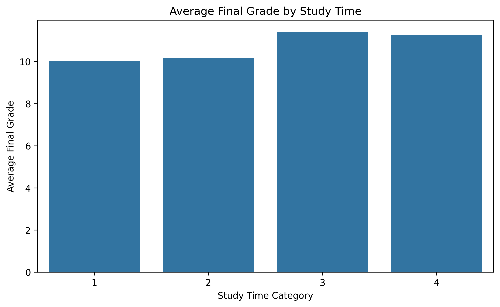

# -student-performance-eda
# Student Performance Data Analysis

### Exploratory Data Analysis using Python

## Project Overview

This project focuses on analyzing student academic performance using Exploratory Data Analysis (EDA).

The objective is to explore student performance patterns and investigate relationships between study time, absences, previous grades, and final grades.

The project uses Python-based data analysis and visualization libraries to extract meaningful insights from student data.

## Dataset Information

- **Dataset:** Student Performance
- **Source:** UCI Machine Learning Repository
- **Records:** 395 students
- **Features:** 33 original columns
- **Target variable for analysis:** G3 (Final Grade)

Dataset link: https://archive.ics.uci.edu/dataset/320/student+performance

## Technologies & Tools

- Python
- Pandas
- NumPy
- Matplotlib
- Seaborn
- Google Colab
- GitHub

## Project Workflow

1. Import Python libraries
2. Load the student performance dataset
3. Understand dataset structure and dimensions
4. Perform statistical analysis
5. Identify missing values and duplicates
6. Analyze numerical and categorical variables
7. Visualize grade distributions
8. Perform correlation analysis
9. Create a correlation heatmap
10. Perform feature engineering
11. Generate analytical insights

## Exploratory Data Analysis

The following areas are explored:

- Student final grade distribution
- Study time and academic performance
- Student absences and final grades
- Relationship between G1, G2 and G3
- Correlation between numerical variables
- Feature analysis and data preparation

## Visualizations

### Study Time vs Final Grade



## Feature Engineering

A new feature named `average_previous_grade` was created using the average of G1 and G2.

This feature helps analyze previous academic performance in relation to the final grade.

## Key Learning Outcomes

- Working with real-world datasets
- Data cleaning and preprocessing
- Exploratory data analysis
- Statistical analysis using Pandas
- Data visualization using Matplotlib and Seaborn
- Correlation analysis
- Basic feature engineering

## How to Run This Project

1. Clone or download this repository.
2. Open the Jupyter Notebook using Google Colab.
3. Install the required libraries if necessary.
4. Run the notebook cells sequentially.
5. Explore the generated charts and analytical results.

## Project Structure

```text
student-performance-eda/
│
├── EDA_PROJECT (1).ipynb
├── study_time_analysis.png
└── README.md
```

## Dataset Acknowledgement

Dataset provided by the UCI Machine Learning Repository.

## Author

**AI/ML Engineering Portfolio – Project 01**
